<div align="center">

# Databricks Lakehouse Studio

### A visual, local-first demonstration of a governed Medallion lakehouse workflow

**Explore data. Run a pipeline. Inspect quality, lineage, and analytics—all from one studio-style interface.**

[](https://www.python.org/)
[](https://www.typescriptlang.org/)
[](#-architecture)
[](#-license)

</div>

---

## Overview

Databricks Lakehouse Studio is a **portfolio and learning project** that brings a sample data-engineering workflow and an interactive dashboard together. It demonstrates how sales records can move through Bronze, Silver, and Gold layers, with pipeline execution, data-quality checks, and analytics in a studio-style interface.

The repository combines Python data-pipeline modules with a React/TypeScript interface. The lakehouse workflow is implemented as a local demonstration; it is not, by itself, a production Databricks deployment.

## Highlights

- **Medallion data flow:** preserve raw records in Bronze, clean and validate in Silver, and create business-oriented Gold data marts.
- **Pipeline orchestration:** model an ordered, multi-stage DAG and inspect execution status and run metrics.
- **Data quality:** evaluate schema, completeness, validity, uniqueness, and business-rule checks; isolate invalid rows in quarantine.
- **Analytics workspace:** explore datasets and issue read-only SQL against the local analytics store.
- **Lineage and governance concepts:** view source-to-mart relationships and role-based access/PII-masking demonstrations.
- **AI-assisted insights concept:** the interface supports an optional AI path and a deterministic fallback; configure external credentials securely before enabling any provider.
- **Live motion background:** a custom Canvas particle network visualizes flowing data and responds to pipeline activity. Motion intensity is adjustable, and the animation respects the browser's reduced-motion preference.

## Live animation preview

The animated diagram below brings the Bronze → Silver → Gold journey to life right here in the README. Glowing packets travel along the pipeline while the layer nodes gently pulse; the animation also turns off when reduced motion is requested.

<p align="center">
  
</p>

The interactive application background is implemented in [`src/components/ParticleCanvas.tsx`](src/components/ParticleCanvas.tsx) with the browser's HTML Canvas 2D API and `requestAnimationFrame`. The SVG above is a lightweight README preview; it does not replace the app's interactive canvas.

## Architecture

```text
Sample sales CSV
      │
      ▼
  Ingestion / validation
      │
      ▼
 Bronze — raw source records
      │
      ▼
 Silver — deduplicated and validated records ──► Quarantine
      │
      ▼
 Gold — curated analytical marts
      │
      ├── Daily revenue
      ├── Product performance
      ├── Regional performance
      └── Customer segments
```

The Python implementation is organized by responsibility under `src/`:

| Area | Purpose |
| --- | --- |
| `src/ingestion` | Source intake and validation |
| `src/bronze` | Raw-layer processing |
| `src/silver` | Cleaning and conformance |
| `src/gold` | Analytical dataset generation |
| `src/orchestration` | DAG and pipeline execution |
| `src/quality` | Data-quality evaluation |
| `src/analytics` | SQL analytics support |
| `src/storage` | Local persistence utilities |
| `src/lineage` / `src/governance` | Lineage and governance demonstrations |
| `src/ai` | AI-assistant logic |
| `src/App.tsx` | React/TypeScript studio interface |

## Technology

- **Backend and data pipeline:** Python
- **Frontend:** React and TypeScript
- **UI details visible in source:** Tailwind-style utility classes, `lucide-react` icons, and custom Canvas animation
- **Local persistence / SQL demonstration:** SQLite
- **Data layout:** CSV and JSON files in `lakehouse_storage/`
- **Data platform concepts:** Databricks Lakehouse and Medallion architecture

> The repository language breakdown is approximately **50.4% Python, 49.1% TypeScript, and 0.5% CSS**. Databricks is the inspiration and target platform concept; the checked-in sample pipeline uses local components unless separately configured.

## Repository contents

```text
.
├── lakehouse_storage/       # Example Bronze, Silver, Gold, quarantine, and run artifacts
├── scripts/                 # Pipeline runner and sample-data generator
├── src/                     # Python pipeline modules and React/TypeScript UI
└── tests/                   # Python unit tests
```

## Getting started

### Requirements

- Python 3.10 or later is recommended.
- A Node.js toolchain is needed to build or serve the React interface once the frontend package configuration is available.

### Python workflow

Clone the repository and create a virtual environment:

```bash
git clone https://github.com/saravanavel07/Databricks-Lakehouse-Studio.git
cd Databricks-Lakehouse-Studio
python -m venv .venv
```

Activate it:

```bash
# macOS / Linux
source .venv/bin/activate

# Windows PowerShell
.venv\Scripts\Activate.ps1
```

The intended project commands are:

```bash
python scripts/run_pipeline.py
python -m unittest discover -s tests -v
```

### Current repository setup note

The checked-in tree currently does not include a root-level `config.py`, a sample input-data directory, a Python dependency manifest, or a frontend `package.json`/lockfile and API server entry point. You may need to supply or configure these pieces before the full pipeline and dashboard can run end to end.

## Tests

Python tests are located in `tests/`. Run them from the repository root with:

```bash
python -m unittest discover -s tests -v
```

The dashboard also includes a control for running tests through its API, which requires the corresponding backend service to be available.

## Configuration and security

- Keep API keys, workspace tokens, and other secrets out of source control. Use environment variables or a suitable secret manager.
- The UI includes optional Databricks connection fields, but a working cloud connector must be configured and implemented separately.
- Treat the governance, permissions, and masking views as demonstrations unless independently enforced by a trusted backend.
- Review and constrain SQL and API operations before exposing the app to untrusted users.

## Contributing

Issues and pull requests are welcome. For changes, please include a short description of the behavior, relevant tests, and any setup/configuration changes required to reproduce it.

## License

No license file is currently included. Unless a license is added, standard copyright restrictions apply; please contact the repository owner before reusing or distributing the code.

---

<div align="center">

Built to explore modern lakehouse ideas—from raw data to trusted analytics.

</div>
